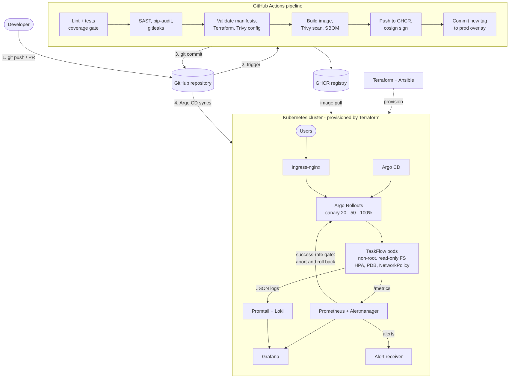

# TaskFlow DevOps Platform - End-to-End Delivery Capstone

**Deepika Gupta** | Roll no. 2301730274 | B.Tech CSE (AI/ML), Section D

A complete, reproducible DevOps platform that takes a small REST service (**TaskFlow API**) from
`git push` to a **canary production rollout on Kubernetes**, with observability, security and
recoverability built in.



| Capability | Implementation | Where |
|---|---|---|
| Version control | Git, trunk-based with PR checks, conventional commits | this repo |
| CI/CD | GitHub Actions: lint, tests (85% gate), bandit, pip-audit, gitleaks, hadolint, kubeconform, promtool, Terraform validate, Trivy, SBOM, cosign | `.github/workflows/ci.yml` |
| Containerization | Multi-stage, non-root (uid 10001), healthcheck, OCI labels | `Dockerfile` |
| Orchestration | Kubernetes via Kustomize (dev/prod overlays), HPA, PDB, quotas | `k8s/` |
| Infrastructure automation | Terraform (kind cluster + Helm platform), Ansible (host bootstrap) | `terraform/`, `ansible/` |
| GitOps | Argo CD auto-sync + self-heal from `k8s/overlays/prod` | `argocd/` |
| Advanced deployment | **Canary** 20% -> 50% -> 100% with Prometheus **auto-rollback** (Argo Rollouts) | `k8s/base/rollout.yaml`, `analysistemplate.yaml` |
| Monitoring | Prometheus, Grafana dashboard, SLO alerts, Alertmanager | `monitoring/`, `k8s/base/prometheusrule.yaml` |
| Logging | Structured JSON logs with request IDs, Promtail -> Loki -> Grafana | `terraform/values/loki-stack.yaml` |
| Security | Pod Security `restricted`, NetworkPolicy default-deny, read-only FS, no SA token, image scan/sign/SBOM, secret scan, SAST | see [docs/SECURITY.md](docs/SECURITY.md) |
| Recoverability | Git-revert / one-click rollback workflow, auto-abort canary, PDB, probes, self-heal | [docs/RUNBOOK.md](docs/RUNBOOK.md) |

## Repository layout

```
app/                 Flask service, Prometheus metrics module, tests
Dockerfile           multi-stage hardened image
docker-compose.yml   local app + Prometheus + Grafana
k8s/base, overlays/  Kustomize manifests (Rollout, Services, Ingress, HPA, PDB, NetworkPolicy ...)
terraform/           kind cluster + ingress-nginx, Argo CD, Argo Rollouts, kube-prometheus-stack, Loki
ansible/             workstation bootstrap playbook
argocd/              GitOps Application
monitoring/          alert rules, dashboard JSON, local Prometheus/Grafana config, alert sink
scripts/             bootstrap, smoke test, load test, canary-failure demo, evidence collector
.github/workflows/   ci.yml (CI + GitOps deploy), rollback.yml
docs/                architecture, runbook, security, evidence/, screenshots/, capstone report
```

## Quick start

### 1. Run tests locally (no Docker needed)
```bash
pip install -r app/requirements-dev.txt
make test            # 16 tests
python3 app/app.py   # http://localhost:8080
./scripts/smoke-test.sh http://localhost:8080
```

### 2. Local stack with dashboards
```bash
docker compose up --build -d
./scripts/load-test.sh http://localhost:8080 60
# Grafana http://localhost:3000   Prometheus http://localhost:9090
```

### 3. Zero-setup: just push to GitHub
Create an empty repository on GitHub, then:
```bash
git remote add origin https://github.com/<your-username>/<repo>.git
git push -u origin main
```
Open the **Actions** tab. The pipeline needs **no secrets and no edits** and runs these jobs:
1. lint + unit tests + SAST, 2. validate Docker/Kubernetes/Prometheus/Terraform files, 3. build, container-smoke-test and publish the image to GHCR,
4. **deploy to a real Kubernetes cluster (kind) inside the runner** and smoke-test it through a Service, 5. GitOps commit of the new image tag.
Each job writes a summary and uploads evidence (test reports, Kubernetes state, pod logs, metrics) as downloadable artifacts.

### 4. (Optional) Full platform on your own machine (kind + Argo + Prometheus + Grafana + Loki)
Prerequisites: Docker, Terraform >= 1.6, kubectl, openssl (`ansible-playbook ansible/bootstrap-host.yml` installs them on Ubuntu).
```bash
./scripts/bootstrap.sh          # detects your GitHub repo from `git remote`, runs Terraform, installs the Argo CD app
echo "127.0.0.1 taskflow.local" | sudo tee -a /etc/hosts
./scripts/smoke-test.sh http://taskflow.local
kubectl -n monitoring port-forward svc/monitoring-grafana 3000:80
```
For the cluster to pull your image, make the GHCR package public (GitHub -> Packages -> taskflow -> Settings -> Change visibility).

### 5. Check everything locally without Docker or a cluster
```bash
./scripts/run-ci-locally.sh     # lint, tests, canary decision simulation, plus any validators you have installed
```

### 6. Demonstrations for the evaluation
| Demo | Command | Expected |
|---|---|---|
| Successful canary | push any change to `main` | pipeline green, Rollouts steps 20->50->100 |
| Automatic rollback | `./scripts/demo-canary-failure.sh` | AnalysisRun fails, rollout **Aborted**, stable pods keep serving |
| Manual rollback | Actions -> *Rollback* -> enter an older SHA | prod overlay repointed, Argo CD re-deploys |
| Alert | run failure demo; watch `TaskflowHighErrorRate` | alert in Alertmanager, payload in `alert-sink` logs |
| Self-healing | `kubectl -n taskflow delete pod -l app=taskflow` | pods recreated, zero downtime (PDB + replicas) |
| Log query | Grafana -> Explore -> Loki: `{namespace="taskflow"} \| json \| level="ERROR"` | structured error logs with `request_id` |

## Proof / screenshots
Real screenshots and charts from running this code are in [`docs/screenshots/`](docs/screenshots) and are embedded in the report `docs/Capstone_Report_DevOps_Platform.docx`.

## Sample data and logs
Real outputs from running this code are in [`docs/evidence/`](docs/evidence): unit-test run, smoke test,
Prometheus metrics scrape, JSON application logs, lint output. Regenerate with `./scripts/collect-evidence.sh`.

## Configuration
| Variable | Default | Purpose |
|---|---|---|
| `LOG_LEVEL` | `INFO` | log verbosity |
| `FAIL_RATE` | `0` | fraction of `/api/*` calls that return 500 (chaos / canary demo) |
| `APP_VERSION`, `GIT_SHA` | set at build | exposed on `/api/version` and `taskflow_build_info` |

## Known limitations
- The task store is in memory (single-replica consistency is not guaranteed across pods); a real deployment would add PostgreSQL. This keeps the capstone focused on the delivery platform.
- Terraform targets a local `kind` cluster for reproducibility at zero cost; the same Helm/Kustomize layers apply to EKS/GKE/AKS by swapping the cluster resource.
- Alertmanager delivers to a stub webhook; configure Slack/email in `terraform/values/kube-prometheus-stack.yaml`.
